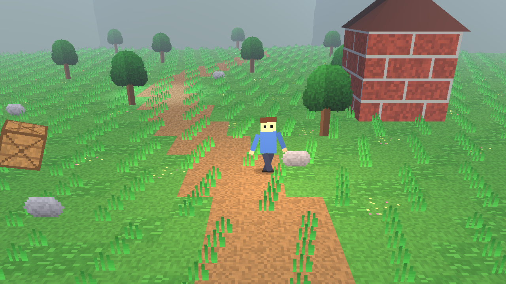
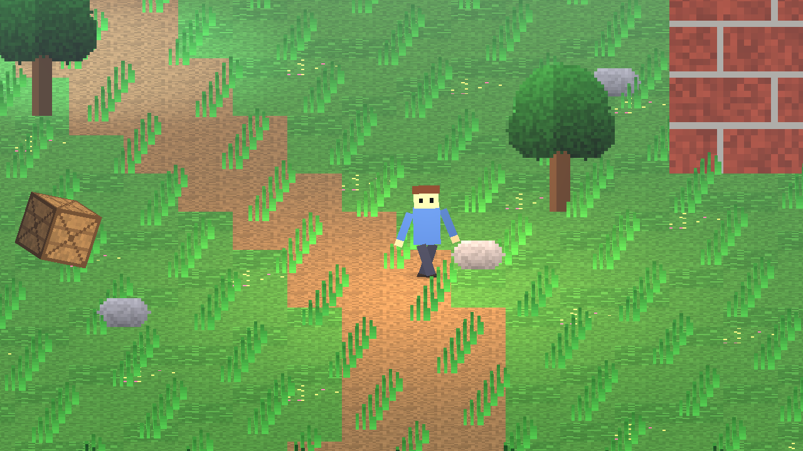
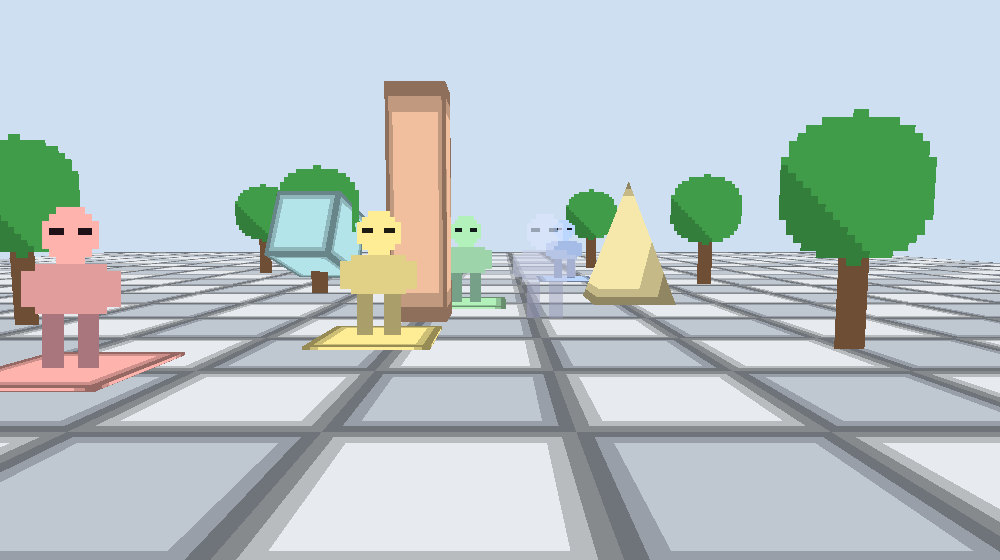

# 2.5D engine

Dimora is a Rust game engine built around a unified spatial model for 2.5D game development. It brings 2D sprites,
tilemaps, skeletal 2D characters, 3D meshes and fully 3D characters into a shared world with coherent transforms,
cameras, depth and rendering, and aims to make hybrid 2D/3D games natural to build through programming APIs combined
with purpose-built visual tools, including a user-friendly editor. It is not tied to one look or camera: perspective,
orthographic, isometric, top-down and side-scrolling views are meant to be configurations of the same world (today
perspective and orthographic are implemented and tested; the others are planned).

**Today** Dimora is a code-driven engine: sprites, tilemaps, a skeletal 2D data model and 3D meshes share one world,
one camera and one set of lights. The editor and the other character types are planned, not built; see
[Status](#status).

> **2.5D is a spatial world, not a fake 2D layer system.** Every object has a real `Vec3` position. Depth drives
> projection, parallax, occlusion and lighting. There is no integer z-index.



The scene above is `examples/basic_2_5d`: a tilemap lying on the ground, ~3000 grass tufts, sprite trees and rocks at
different depths, a skeletal player assembled from sprite parts, a 3D brick building and mountains, a spinning 3D
crate, three lights and distance fog. All of it is one world. Only the camera projection differs below:

| Perspective | Orthographic (same framing) |
|---|---|
|  |  |

## Requirements

**Rust.** [`rust-toolchain.toml`](rust-toolchain.toml) pins the development toolchain (stable 1.99.0 with `rustfmt` and
`clippy`); with [rustup](https://rustup.rs) installed, `cargo` fetches it automatically on first use. The minimum
supported version is **1.90** (`rust-version` in `Cargo.toml`): `cargo test --workspace --locked` was run on exactly
1.90.0 on macOS arm64, and older compilers are refused by the locked dependencies (`ordered-float`, via wgpu, needs 1.90
on Linux and Windows). To try the minimum yourself: `cargo +1.90.0 test --workspace --locked`.

**A GPU adapter.** The renderer and its pixel tests use [wgpu](https://wgpu.rs), which picks the backend per platform:

| Platform | Backend | What you need |
|---|---|---|
| macOS | Metal | Nothing to install beyond the Xcode command line tools (`xcode-select --install`). Verified on an Apple M5 |
| Linux | Vulkan | A Vulkan driver. On a machine without a GPU (VM, CI) install the lavapipe software driver: `sudo apt install mesa-vulkan-drivers` (Debian/Ubuntu) |
| Windows | DX12 or Vulkan | A normal GPU driver. Not verified by the project yet |

No windowing setup is needed for the tests: they render offscreen. The examples open a normal window.

**Verify a checkout** with one command, the same one CI will run:

```sh
scripts/check.sh
```

It runs `cargo fmt --check`, `cargo clippy --workspace --all-targets -- -D warnings`, `cargo test --workspace` and
`cargo doc --workspace --no-deps` with `RUSTDOCFLAGS="-D warnings"`, stops at the first failure and says which step
failed. It works on macOS and Linux and sets `DIMORA_REQUIRE_GPU=1` for the tests (see [Testing](#testing)).

## The spatial proof: `spatial_scene`



One world, one camera: four identical figures at Z = 0, 100, 300 and 600, a pillar mesh between figures B and C (B is
in front of it, C is behind it), a cube mesh cutting through a tree sprite, a translucent sprite blended over the floor,
all unlit so only the projection shows. Perspective shrinks the figures with depth; orthographic does not. Moving the
camera produces parallax in perspective and a uniform shift in orthographic, with no per-object parallax value anywhere
(see [`docs/spatial_scene_parallax.png`](docs/spatial_scene_parallax.png)).

```sh
cargo run --release -p spatial_scene
```

| Key | Action |
|---|---|
| `W` / `S` | Move the camera in depth |
| `A` / `D` | Strafe |
| `Space` / `Shift` | Camera up / down |
| Arrow keys | Rotate the camera (yaw / pitch) |
| `P` | Perspective / orthographic |
| `O` | Cycle sprite orientation: billboard, upright, fixed |
| `R` / `Esc` | Reset camera / quit |

The rendering model (world vs render state, depth vs order vs position, orientation, conventions) is written up in
[`docs/SPATIAL_RENDERING.md`](docs/SPATIAL_RENDERING.md).

## Run the larger demo

`basic_2_5d` adds tilemaps, a skeletal character, lights and fog:

```sh
cargo run --release -p basic_2_5d
```

Needs a GPU adapter (Metal on macOS, Vulkan on Linux, DX12 or Vulkan on Windows); see [Requirements](#requirements),
including the software Vulkan driver for machines without a GPU.

| Key | Action |
|---|---|
| `WASD` / arrows | Move the player (X and Z on the ground) |
| `P` | Toggle perspective / orthographic: watch parallax appear and disappear |
| `Q` / `E` | Tilt the camera |
| Mouse wheel | Zoom (camera distance) |
| `L` | Toggle the lantern (point light) |
| `Esc` | Quit |

The window title shows live stats (visible sprites/meshes, lights, draw calls, fps).

Headless screenshot (no window; used for the images in `docs/`):

```sh
cargo run --release -p basic_2_5d -- --screenshot out.png [--ortho] [--size 1280x720] [--distance 10]
```

## What a game looks like

```rust
use engine::prelude::*;

let mut game = Game::new(GameConfig::default().with_title("my game"));

// Assets are addressed by name; components can reference them before they exist.
// `insert` fails (and never overwrites) if two different names hash to the same asset id.
game.assets().insert("ground", Texture::solid(16, 16, [90, 150, 70, 255])).unwrap();

game.world.spawn((Transform::from_xyz(0.0, 3.0, -10.0), Camera::perspective(45.0)));
game.world.spawn((Transform::from_xyz(0.0, 0.0, 100.0), Sprite::new("player")));   // real depth: Z = 100
game.world.spawn((Transform::from_xyz(5.0, 0.0, 300.0), Mesh::new("tree")));       // a 3D mesh at Z = 300

game.add_system("gameplay", |world| { /* plain `FnMut(&mut World)` */ });
game.run().unwrap();
```

See `examples/basic_2_5d/src/main.rs` for a complete, working version of this.

## Coordinate system

Left-handed, **+Y up, +Z away from the default camera** (into the screen), +X right. "Z = 800" means far away. A camera
with identity rotation looks down +Z. Sprites are quads whose facing is chosen by `Sprite.orientation` (billboard by
default); a `Fixed` sprite lies in its local XY plane and faces -Z. Full conventions are in
[`docs/SPATIAL_RENDERING.md`](docs/SPATIAL_RENDERING.md).

## Crates

| Crate | Responsibility |
|---|---|
| `engine-math` | `Vec2/3/4`, `Quat`, `Mat3/4`, `Transform`, `Rect`. No dependencies. |
| `engine-core` | `Color`, `Time`, `FixedTimestep`, `Input`. No platform or GPU knowledge. |
| `engine-world` | ECS world (wraps [`hecs`](https://crates.io/crates/hecs)), resources, `Schedule`, transform hierarchy. |
| `engine-assets` | `AssetId`/`AssetKind`/`AssetHandle<T>`, `AssetManager`, sources, texture/sprite/mesh data. No renderer. |
| `engine-animation` | `Skeleton`, bones as hierarchy entities, clips, `AnimationPlayer`. |
| `engine-renderer` | Backend-agnostic render model: projection, camera, components, extraction, culling, sorting, batching. No GPU. |
| `engine-renderer-wgpu` | The [`wgpu`](https://wgpu.rs) backend. Consumes a `RenderScene`; never sees the ECS. |
| `engine-platform` | `winit` window/event loop to `InputEvent`s and frame time. |
| `engine` | Facade: `Game`, schedules, prelude. |

Design rationale, trade-offs (why `hecs`, why wgpu, handedness, ordering rules) and the frame pipeline are in
[`docs/ARCHITECTURE.md`](docs/ARCHITECTURE.md).

## Testing

```sh
cargo test --workspace   # just the tests
scripts/check.sh         # fmt, clippy, tests and docs, all warnings denied; see Requirements
```

Math, hierarchy, assets, projection/parallax, culling, depth sorting and batching are covered by plain unit tests.
`crates/engine-renderer-wgpu/tests` renders small scenes offscreen and checks pixels (depth interleaving of sprites and
meshes, face culling, world-space lighting, draw-call counts).

**No GPU adapter.** By default those GPU tests print `skipping GPU test: ...` and still report `ok`, which means a
green run on a machine without a GPU proves nothing about rendering. Set `DIMORA_REQUIRE_GPU=1` and a missing adapter
makes them fail with a message saying that no GPU adapter was found (on Linux it suggests
`sudo apt install mesa-vulkan-drivers`). `scripts/check.sh` sets it. Run
`cargo test -p engine-renderer-wgpu -- --nocapture` to see which adapter the tests used.

To see the failure path on purpose, remove the adapter: on Linux `VK_ICD_FILENAMES=/nonexistent`, on macOS
`WGPU_BACKEND=vulkan` (Vulkan is not built on macOS, so no adapter is found), for example
`DIMORA_REQUIRE_GPU=1 WGPU_BACKEND=vulkan cargo test -p engine-renderer-wgpu`.

## Status

Dimora is early. The foundation (math, ECS wrapper, transforms and hierarchy, asset manager, platform loop) and
the spatial renderer (perspective and orthographic cameras, depth-sorted sprites and meshes, sprite orientation
modes, forward lighting and fog, camera viewports) exist and are covered by tests. Basic tilemaps and a skeletal animation data model
exist but are limited (see ROADMAP.md). There are no particles, collision, audio, UI, shadows,
scene serialization, asset bundling or editor.

Planned but not started: three character representations (sprite sheet, skeletal 2D, 3D skinned) over one
gameplay model, a UI runtime, and gameplay scripting. See `ROADMAP.md` for their order and prerequisites. The current
milestone is M3a, the frame model (stages, commands, events), not started.

Each question has one home, so documents do not compete:

* [`docs/VISION.md`](docs/VISION.md): what Dimora is for, its principles, platforms and non-goals.
* [`docs/CAPABILITIES.md`](docs/CAPABILITIES.md): every system's status **today** (with evidence) versus planned.
* [`docs/ARCHITECTURE.md`](docs/ARCHITECTURE.md): how it is built, cross-system requirements and the risk register.
* [`docs/DECISIONS.md`](docs/DECISIONS.md): open and made decisions; records in [`docs/adr/`](docs/adr/).
* [`ROADMAP.md`](ROADMAP.md): milestones in dependency order, with prerequisites and acceptance criteria.
* [`TASKS.md`](TASKS.md): the current milestone, its tasks, known issues, blockers and evidence.

Contributors and agents also follow the project rules in [`.cursor/rules/`](.cursor/rules/).
