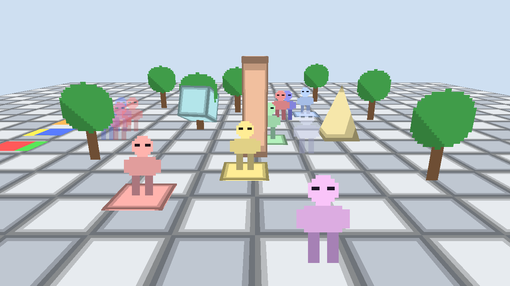
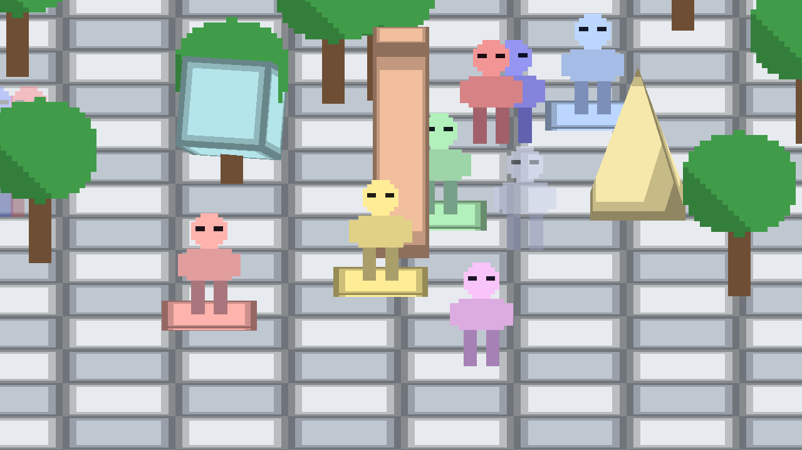
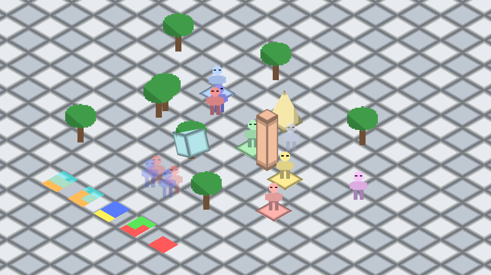
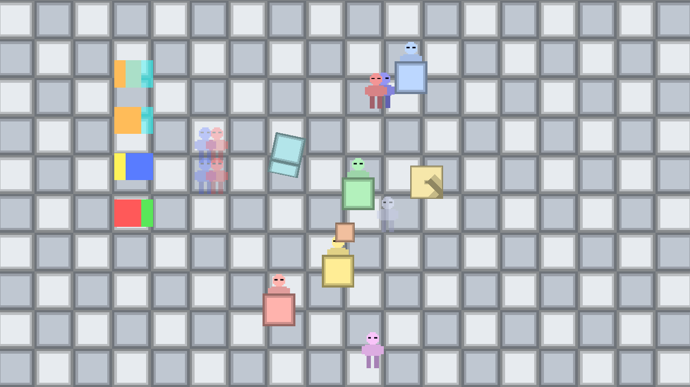
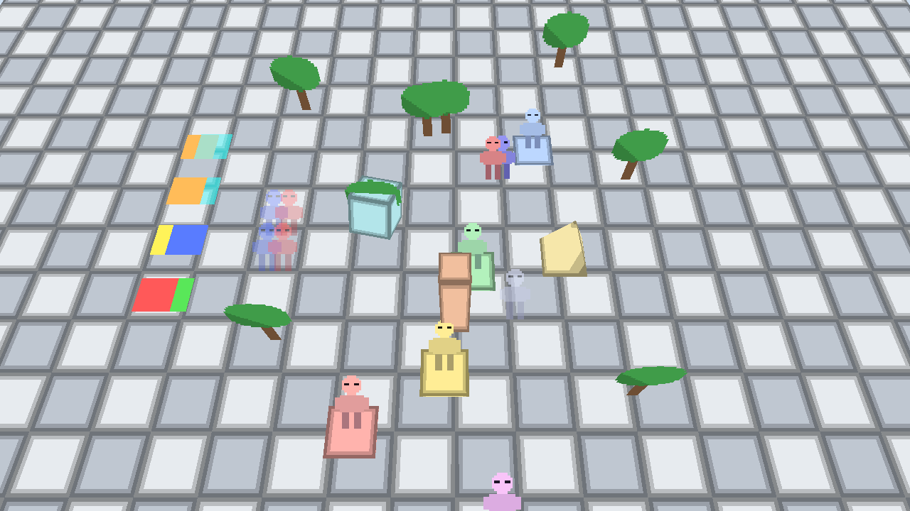
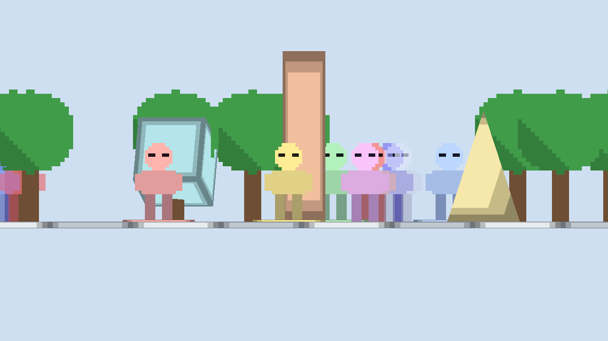
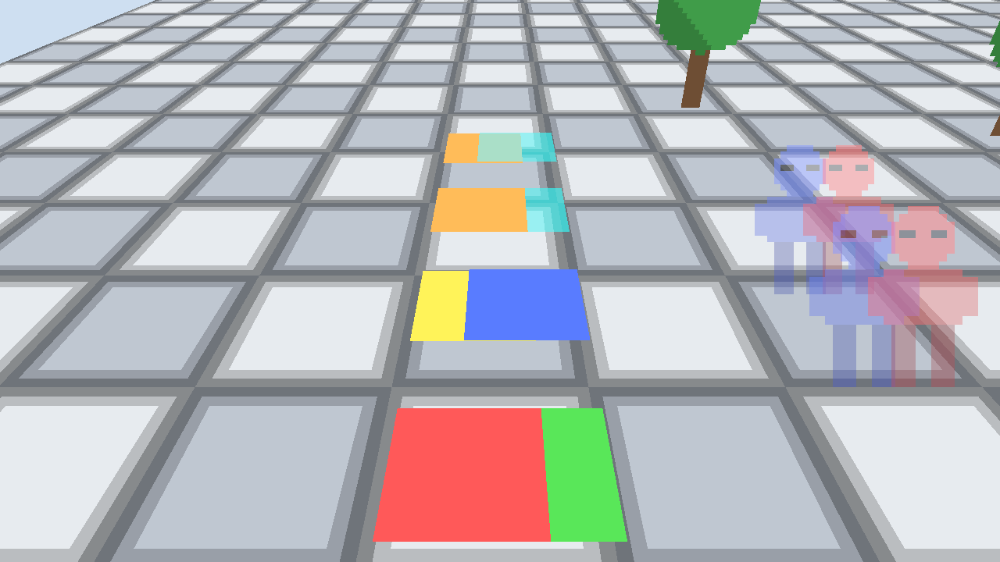
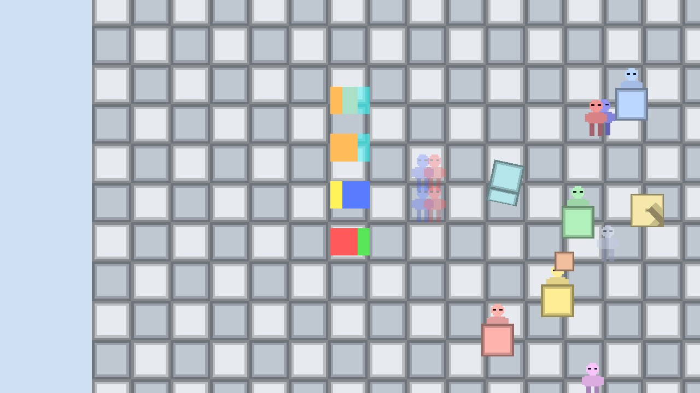
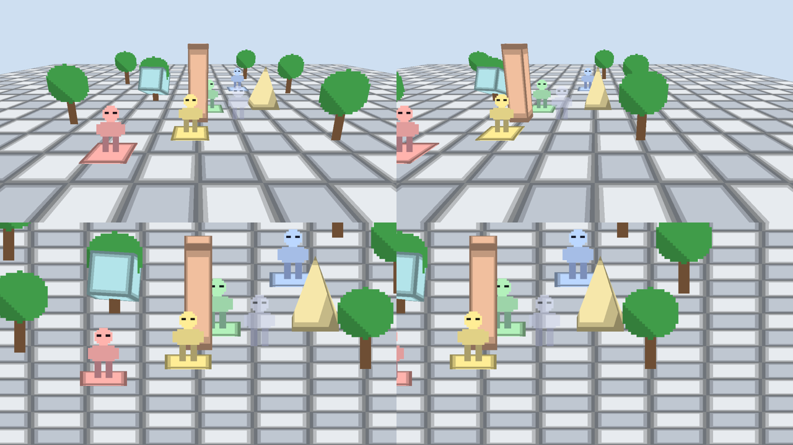

# Spatial rendering

> **Everything exists in spatial coordinates first. Rendering is the projection of that spatial
> world into an image.**

This document describes how a thing in the Dimora world becomes pixels, and which concept is
responsible for what. [ARCHITECTURE.md](ARCHITECTURE.md) covers the crate layout; this file is
about the rendering model. The runnable proof is `examples/spatial_scene`.

## Why 2.5D is a spatial problem

A common way to build 2.5D is a stack of 2D layers: each sprite gets an integer layer, layers are
sorted, and "parallax" is a per-layer multiplier on camera movement. It works for a fixed camera
and falls apart as soon as the camera moves in depth, a 3D object enters the scene, or a sprite has
to be in front of one thing and behind another. Every one of those needs a special case, because
the model never knew where anything *was*.

Dimora does the opposite. Every renderable is an entity with a real 3D `Transform`. A camera has a
`Transform` too. Sprites, 3D meshes, tilemaps and skeleton parts all go through the same chain:

```text
World                entities, components (no GPU types)
  │  Transform / GlobalTransform   (+ Parent/Children hierarchy)
  ▼
Spatial Transform    where each object is: position, rotation, scale in world space
  │  CameraView::new(Camera, GlobalTransform, target size)
  ▼
Camera               view = inverse of the camera's world transform
  │  Projection::matrix(aspect)
  ▼
Projection           orthographic or perspective: view space -> clip space
  │  extract_scene(world, assets, target) -> RenderScene
  ▼
Render extraction    visibility, frustum culling, sprite quad generation, ordering, batching
  │  SceneRenderer::render(&RenderScene)
  ▼
Renderer             GPU resources, pipelines, instance buffers, draw calls
  │  vertex shader: clip = view_proj * world_position, then perspective divide
  ▼
GPU                  NDC -> viewport rectangle -> depth test -> pixels
```

Nothing after the first arrow is told "this sprite is on layer 3". It is told *where the sprite
is*. Parallax, perspective scaling, occlusion between a sprite and a mesh, and (later) lighting and
shadows fall out of the same positions. The tests in `crates/engine-renderer/tests/camera.rs` check
those claims numerically: with a perspective camera the screen shift of an object when the camera
moves is inversely proportional to its distance, and with an orthographic camera it is identical
for every object.

## Conventions

These are fixed and used everywhere, including shaders. `+Y` up with an `XZ` ground plane is the current engine
convention (provisional, [ADR-0004](adr/0004-one-spatial-world-many-camera-configurations.md)); it is not
configurable per game, and a movement plane is a gameplay choice, not the ground plane.

| Item | Convention |
|---|---|
| Handedness | **Left-handed** |
| Axes | `+X` right, `+Y` up, `+Z` forward / deeper into the scene |
| World units | Unitless; the engine assumes no scale (`basic_2_5d` uses metres, `spatial_scene` uses roughly centimetres). Sprites carry `pixels_per_unit` to convert from texture size |
| Camera forward | The camera entity's local `+Z`. Identity rotation looks down `+Z`; positive yaw (rotation about `+Y`) turns it towards `+X`; positive pitch (about `+X`) tilts it down |
| Rotations | Right-hand rule about the given axis (`Quat::from_rotation_x/y/z`) |
| View space | Camera at the origin, `+X` right, `+Y` up, `+Z` into the screen. View depth is the `Z` of a point in this space |
| Clip / NDC | wgpu/D3D style: x and y in `[-1, 1]` (`+Y` up), depth in `[0, 1]` (`0` near plane, `1` far plane) |
| Screen pixels | Origin at the **top-left** of the camera's viewport, `+X` right, `+Y` down |
| Matrices | Column-major, column vectors: `clip = proj * view * model * v` |
| Mesh winding | Triangles are wound so `(c - a) x (b - a)` is the outward normal; the pipeline uses `FrontFace::Ccw` + back-face culling |
| Sprite anchor | Normalized within the sprite rectangle: `(0, 0)` bottom-left, `(1, 1)` top-right. The anchor sits exactly at the entity's position. Default `(0.5, 0)` = bottom-centre (feet) |
| Sprite facing | A sprite quad faces local `-Z` (towards a default camera); the quad's own `+X`/`+Y` are its right/up |

## World state vs render state

The boundary is the `RenderScene`:

```text
World state (engine-world, engine-renderer components)   Render state (engine-renderer-wgpu)
────────────────────────────────────────────────────     ──────────────────────────────────
Transform, GlobalTransform, Parent, Children             wgpu Device / Queue / Surface
Camera { projection, viewport, ... }                     Pipelines, bind group layouts
Sprite, Mesh, Material, TileMap, RenderOrder             GPU textures + bind groups (cache)
AssetHandle<T> (a name hash)                             GPU vertex/index buffers (cache)
                                                         Instance buffers, depth texture
          │                                                         ▲
          └──── extract_scene ──► RenderScene (plain data) ─────────┘
```

* ECS components hold **only** plain data and `AssetHandle`s. There is no `wgpu` type in
  `engine-world`, `engine-assets`, `engine-renderer` or in any component. A gameplay system never
  needs the `wgpu` crate.
* `extract_scene` reads the world and produces a `RenderScene`: the camera view, instance lists and
  batches. It contains no ECS or asset-manager references.
* `engine-renderer-wgpu` consumes a `RenderScene` and owns every GPU object. Its texture and mesh
  caches are keyed by `AssetId` and remember the asset revision, so a reloaded asset is re-uploaded.
  An entry is evicted when its asset is removed from the `AssetManager` or when no frame has used it for a
  configurable number of frames (120 by default); `SceneRenderer::cache_stats()` reports the counts.
* The world never issues a `RenderPass` call. The renderer decides how to draw what exists.

Because the seam is a plain struct, a second backend, a headless recorder or a replay tool needs
only a `RenderScene`.

### GPU resource boundaries

| Concept | World-side (data) | Renderer-side (GPU) |
|---|---|---|
| Texture | `Texture` asset (pixels), `AssetHandle<Texture>` | `wgpu::Texture` + bind group, cached by id + revision |
| Mesh | `MeshData` asset (vertices, indices), `Mesh` component | Vertex/index buffers, cached by id + revision |
| Material | `Material` (color, optional texture, `lit`) | Resolved into per-instance color + texture bind group |
| Sprite | `Sprite` (+ `SpriteAsset`: texture, UV rect, pivot) | One unit quad shared by all sprites; per-instance data |
| Pipeline | none | Sprite cutout / blend, mesh; created once |
| Buffer | none | Growable instance buffers, uploaded per frame |

`Material` is deliberately tiny. It is the seam where a real material system will attach.

## Spatial renderables

Renderables are plain components next to `Transform`, not a trait hierarchy:

```text
Sprite     texture region placed in the world      (batched, instanced)
Mesh       indexed triangles + Material            (batched by mesh + texture)
TileMap    a grid of cutout quads                  (same instanced path as sprites)
(Skeleton parts are Sprites in a bone hierarchy; particles are future)
```

An enum or trait would force dynamic dispatch or one giant match on the hot path. Components keep
each kind in its own archetype and its own tight extraction loop, while *all* of them share the same
spatial inputs: `GlobalTransform`, `Visibility`, the active `CameraView`, and the frustum.

## Camera

A camera entity has exactly three parts:

```text
Transform     where it is and where it looks (the view is the inverse of its world matrix)
Camera.projection  Orthographic | Perspective   (CameraProjection is non_exhaustive)
Camera.viewport    ViewportRect: the part of the render target it draws into
```

`CameraView` resolves them for a given render target and carries everything downstream needs:
`view`, `proj`, `view_proj`, position, forward/right/up, and the viewport rectangle in pixels. The
aspect ratio comes from the viewport rectangle, not the window, so a camera in half the window is
not stretched. The same `view_proj` drives CPU projection (`CameraView::project`, picking
rays, culling) and the GPU, so the two cannot disagree.

The `Projection` trait describes the extension point: anything expressible as a view-to-clip matrix
(isometric, oblique, side-scroller) would work with culling, picking and the GPU unchanged. Today
`Camera` stores the closed `CameraProjection` enum rather than an arbitrary `impl Projection`, so a
new projection currently needs a new enum variant (KI-11 in TASKS.md).

### Orthographic

Parallel projection. X and Y map linearly to the screen, Z only affects depth (what is in front)
and clipping. Two objects at different Z with the same X/Y land on the same pixel, and objects keep
their apparent size at any depth. Moving the camera shifts every object by the same amount: no
parallax, because there is no per-object parallax value to apply.

### Perspective

Pinhole projection. Apparent size is proportional to `1 / view_depth`, and a camera move shifts
nearer objects more than farther ones. With the `spatial_scene` home camera (50 degree vertical field of view, 215 units up, 420 units
back, pitched 0.3 rad down), a 96-unit figure at Z = 0, 100, 300 and 600 sits at view depths of
465, 560, 751 and 1038 and covers about 159, 132, 99 and 71 pixels on a 720p frame.

## Depth, order and position are different things

| Concept | What it is | Who owns it |
|---|---|---|
| **World position** | Where an object is in the world (`Transform`, `GlobalTransform`) | Gameplay / the world |
| **Camera-space (view) depth** | Distance in front of the camera along its forward axis; the `Z` of a point after the view matrix | Derived from position + camera. Never stored |
| **GPU depth** | The depth-buffer value after projection (`0..1`, non-linear for perspective) | The GPU, per fragment |
| **Screen position** | Pixels in the camera's viewport | Derived by projecting a world position |
| **Transparent-object ordering** | The order alpha-blended things are drawn in, so blending composes correctly | The extractor: back-to-front by view depth |
| **Render layer or queue** | Which pass, group or camera content belongs to. **Not implemented** beyond the opaque, cutout and blended pass split; not the same thing as `RenderOrder.layer` | The renderer |
| **Explicit render order** | An optional override (`RenderOrder`), for deliberate ordering where depth cannot decide, such as coplanar content. Never a substitute for depth | The game, when depth cannot decide |
| **Camera projection** | How view space maps to the image | `Camera.projection` |

Rules that follow:

1. **Opaque geometry is resolved by the GPU depth buffer.** Meshes, tilemap tiles and `Cutout`
   sprites (alpha-tested, write depth) can be submitted in any order and intersect correctly, with
   each other too. A cube can cut through a tree sprite; a sprite can be in front of, behind or
   beside a mesh purely from where they are. There is no sprite-versus-mesh special case.
2. **Alpha-blended sprites cannot use the depth buffer alone**, because blending is order
   dependent. They are drawn last, depth-tested but without depth writes, sorted back-to-front by
   *view-space* depth of the quad centre. This is a secondary mechanism for transparency, not the
   visibility architecture; it is not a global `sort_by_z()`: it applies only to the blended
   subset and uses camera-space depth, so it is correct for any camera orientation.
3. **`RenderOrder { layer, order }` is optional and never positional.** It is an additional
   component for blended sprites. `layer` dominates depth, `order` breaks ties at equal depth.
   Entities without it are `(0, 0)`, which leaves depth in charge. It does not move anything, does
   not affect opaque geometry, and does not affect projection.

These four ideas (spatial depth, transparency sorting, render layers or queues, explicit order) are kept
distinct on purpose ([ADR-0004](adr/0004-one-spatial-world-many-camera-configurations.md), decision 4). Today
`RenderOrder` reaches blended sprites only. The depth point used for sorting is the quad centre.
Configurable sort or occlusion policies for isometric styles are left room for and not built. No mechanism
was chosen from the cases below (D-48).

### Coplanar conflicts the test scene verified (2026-10-14)

`spatial_scene` lays flat `Fixed` decals on the `XZ` ground and samples their overlap under every
configuration that is not edge-on to them (`side` is excluded: a flat decal has no area). These three are
verified limitations. The tests pin the behaviour; they are expected to fail the day a mechanism removes it,
and the finding should be updated in the same change. None of them is a chosen design.

| Conflict | What happens | Test |
|---|---|---|
| Two cutout decals at the same height, overlapping in `XZ` | The one spawned first keeps the overlap in every configuration that can see the ground. Swapping the tints makes the first entity's new colour win, so nothing spatial decided it | `equal_height_cutout_decals_are_decided_by_draw_order_not_by_space` |
| A cutout decal in the same plane as the slab tops (`Y = 0`) | Shown under some cameras and hidden under others. The test requires at least one of the five downward configurations to show it (≥ 90% of samples) and at least one to hide it (≤ 10%). On Apple M5 (Metal) that day, orthographic showed it and perspective, isometric, top-down and steep hid it. That named split is one GPU's rounding, not a portable rule | `known_conflict_a_decal_coplanar_with_a_mesh_is_hidden_or_shown_by_rounding` |
| A blended decal at the same height as a cutout one | Visible under some cameras and hidden under others. The test requires the blended colour over the cutout in ≥ 80% of samples under at least one configuration and in < 20% under at least one other. On the same machine, isometric showed it (about 99%) and the other four hid it. Same caveat: the names are that run, the split is the limit | `known_conflict_a_blended_decal_at_the_same_height_as_a_cutout_one_depends_on_the_camera` |

Cutout decals one unit apart in height, and a blended decal one unit above a cutout one, resolve by depth
in all five downward configurations (`decals_a_little_apart_in_height_resolve_by_depth_in_every_configuration`).
`RenderOrder.layer` decides overlapping blended sprites whichever way the camera looks.
`RenderOrder.order` decides only when the view depths actually tie: it does under perspective, orthographic
and side, and it does not under isometric, where the yaw separates the view depths
(`render_order_order_only_breaks_ties_at_equal_view_depth`).

Sorting uses the sprite quad's centre, so intersecting blended quads or large blended quads that
span a wide depth range can mis-order. The usual fix is to make those sprites `Cutout`.

## Sprites

```rust
Sprite {
    asset,         // SpriteAsset: texture + UV rect + natural size + pivot
    region,        // optional sub-rectangle of the asset (sprite-sheet frames)
    size,          // world size; None = asset's natural size
    anchor,        // pivot inside the quad; None = asset's pivot
    flip_x, flip_y,
    tint,          // Color with alpha
    orientation,   // Billboard | Upright | Fixed
    blend,         // Cutout | Alpha
    lit,
}
```

A sprite stores no screen or world position. The renderer takes `Transform + Sprite + Camera` and
produces world-space quad geometry. When any entity has a stored previous local, extraction
substitutes the composed render matrix from ADR-0007 for `GlobalTransform` before placement, culling,
and depth sorting. Those components are not written. With no stored previous, extraction still uses
`GlobalTransform`.

```text
GlobalTransform ──┐
Sprite.orientation ┼─► sprite_placement ─► model matrix = placement * anchor * size ─► SpriteInstance
CameraView ───────┘                                                                      │
                                                          shader: clip = view_proj * model * quad corner
```

### Orientation

| Mode | Quad axes | Use |
|---|---|---|
| `Billboard` (default) | The camera's right/up; faces the view plane | Particles-like sprites, effects, anything that should always read flat to the screen |
| `Upright` | Horizontal right, world `+Y` up; faces the camera's heading | Characters and props standing on ground, under a tilted camera |
| `Fixed` | The entity's own matrix | Decals, signs, anything lying in the world; the quad is edge-on when seen edge-on |

Billboards align to the camera's **view plane**, not to the camera's position. Every billboard
therefore has the same orientation in a frame, so a perspective camera does not rotate or skew
individual sprites (important for pixel art); they only change position and apparent size.

For `Billboard` and `Upright`, the entity's position and scale are used. Its twist about its own
Z axis (roll) is kept, so a bone can still swing a billboarded arm; its pitch and yaw are ignored
because the camera decides them. A negative scale mirrors the sprite.

The quad is generated on the CPU in extraction (one matrix per sprite). That keeps the shader
identical for every orientation mode and makes new modes (axis-constrained, custom) a change to one
function, `sprite_placement`. Orientation is a rendering decision, so it lives in `Sprite`, not in
`Transform`: the entity's `Transform` always says *where* the sprite is.

### What `Upright` does in the test scene

This is the current extraction rule, measured, not a decision that it should stay this way (D-26).
`Upright` builds a vertical quad and turns it about world `+Y` to face the camera's heading. A pitched
camera therefore foreshortens it.

| View | Measured against a billboard of the same sprite | Test |
|---|---|---|
| Orthographic, pitch 0.3 rad; isometric; side (pitch 0) | On-screen height is `cos(pitch)` times the billboard. Exact, because the projection is orthographic | `an_upright_sprite_is_foreshortened_by_the_cosine_of_the_pitch_in_orthographic_views` |
| Top-down (looking along −Y) | Edge-on: under half a pixel, against more than 5 px for the billboard. Looking straight along `+Y` has no heading, so extraction falls back to the camera's right axis and the quad stays vertical | `an_upright_sprite_collapses_to_a_line_when_the_camera_looks_straight_down` |
| Steep (perspective, pitch 1.05 rad, about 60°) | Projected height between 0.4 and 0.65 of the billboard. Not exactly `cos(pitch)`, because the projection is perspective | same test, the steep assertion |

`orientation_modes_under_each_configuration` counts pixels: a billboard has area under every configuration,
including top-down; `Upright` and `Fixed` have none when the camera looks straight down. A billboard standing
on a mesh pad keeps its pixels under the shallower views and loses about half of them top-down, where the
quad lies in the ground plane and the pad cuts it
(`a_billboard_standing_on_a_mesh_is_cut_by_it_when_the_view_is_steep_enough`).

The shader's world-space normal for lighting is derived from the final quad, so billboards and
fixed quads are shaded consistently.

## Meshes

`Mesh { asset, material }` plus the entity's `Transform` is all a mesh needs. `Material` is a
colour, an optional texture and a `lit` flag; `Material::unlit` gives a flat colour. Meshes use the
same `GlobalTransform`, the same `CameraView` and the same depth buffer as sprites. The `Mesh` path
batches instances of the same mesh and texture into one draw call.

## Batching

* Sprites become `SpriteInstance` records (model matrix, UV rect, tint, flags). Consecutive
  instances sharing a texture become one instanced draw. A sprite never issues its own GPU
  commands, and batches never reorder instances, so correctness never depends on batching.
* Cutout sprites and tiles are grouped by texture to minimise batches; blended sprites keep their
  depth order.
* Meshes are sorted by `(mesh, texture)` and merged into instanced draws; per-instance colour keeps
  that from splitting batches.
* In `spatial_scene`, hundreds of floor-tile meshes are a handful of draw calls. In
  `basic_2_5d`, 3000 grass tufts plus tiles are a single sprite draw call.
* Culling (a bounding sphere against the camera frustum) runs before instances are created.
* Left room for: texture atlases (sprites already reference a UV rect), material batching, GPU-driven
  instancing and culling.

## Camera configurations

Each row is one function in `examples/spatial_scene/src/cameras.rs`. It returns a `Camera` and a `Transform`,
and the example edits both afterwards. They are not an engine API, and isometric is not a projection variant.
Switching among them changes only those two values. Extraction and the wgpu backend have no branch on the name.

| Name | Projection | Placement | Holds in the tests | Does not |
|---|---|---|---|---|
| `perspective` | Perspective, 50° vertical field of view | (0, 215, −420), yaw 0, pitch 0.3 rad | Occlusion both ways; a projected point picks back to itself | |
| `orthographic` | Orthographic, height 400 | The same transform | The same, with no parallax. `Upright` height is `cos(0.3)` of a billboard | |
| `isometric` | Orthographic, height 900 | Yaw 45°, pitch `atan(1/√2)`, looking at (0, 60, 300) | The same. It is a rotated orthographic camera | `RenderOrder.order` does not break the equal-world-depth ghost pair: the yaw separates their view depths |
| `top-down` | Orthographic, height 1000 | Pitch 90°, looking along −Y, +Z toward the top of the image | Billboards face the camera. Flat decals are visible | `Upright` and vertical `Fixed` quads are edge-on |
| `steep` | Perspective, 50° | Pitch 1.05 rad (about 60°), same focus | The same occlusion and picking | `Upright` is roughly half a billboard; that ratio is not a settled design |
| `side` | Orthographic, height 400 | Level, looking along +Z | The same occlusion and picking | Flat ground decals are edge-on. Not a 2D-style game |
| custom | Not available | | | `Camera` holds a closed enum (KI-11, D-25) |

## The example: `spatial_scene`

```text
cargo run --release -p spatial_scene
cargo run --release -p spatial_scene -- --screenshot out.png [--camera NAME | --ortho]
    [--environment a|b] [--cam x,y,z] [--yaw deg] [--pitch deg] [--size WxH]
    [--orientation billboard|upright|fixed] [--frames N]
```

`NAME` is `perspective`, `orthographic`, `isometric`, `top-down`, `steep` or `side`. `--ortho` is the
orthographic configuration. `--frames N` renders N frames and exits with an error if the GPU cache grew.
The default environment is A. `--environment b` publishes the yard before the first step.

Environment A is a checkerboard of mesh slabs on the `XZ` plane (`+Y` up), four cutout figures at Z = 0,
100, 300 and 600, overlapping cutout figures, cutout trees, blended ghosts (one pair with `RenderOrder`),
a pillar, a spinning cube and a pyramid, and the flat decal bench at the left. It is unlit. Environment B
is a smaller yard in the same view: four floor tiles, a lit cube, a pillar, a figure, a tree, and one
point light. Both are `SceneBuilder` functions. Replacing one does not remove assets.

The camera and the walker are not members of either environment. The walker is moved by a `Transform`
write and keeps that entity across a switch. Tab queues one deferred replacement; holding it does not
queue another. The world stays on the current environment until the stage flush, and the tracked instance
id changes only after that replacement reports success. A failure leaves the current environment in place
and is logged when the status becomes `Failed`. An unexpected load stays published, and an unexpected
unload is left as the engine applied it: the switch logs that it does not own that instance and does
not unload or rebuild it.

Controls: `W/S` move in depth, `A/D` strafe, `Space/Shift` move up/down, arrows rotate, `C` selects the next
configuration, `P` toggles perspective/orthographic on the current pose, `O` cycles the figures' sprite
orientation, `R` returns to the current configuration, `Tab` switches environment, `Esc` quits.













Perspective, orthographic, isometric, top-down, steep and side, in that order. Top-down, the standing sprites
are edge-on except the billboards, which lie flat on the ground. Side-on, the flat decals disappear.



The decal bench, perspective, camera moved onto it. Nearest large pair: two cutout decals at equal height;
red was spawned first and keeps the overlap. The yellow and blue pair is one unit apart in height, and blue
wins. Farther up, one orange/cyan pair is the blended decal at the cutout's height and the other is the
blended decal a unit above it. The torn red fragment at the bottom edge is the decal coplanar with the slabs.



The same bench looking straight down. The equal-height red/green pair still gives the overlap to red. The
decal that shares the slab plane is absent. Both pictures are illustrations of the 2026-10-14 Apple M5 run;
the tests, not these pixels, are the verification.

### Earlier pictures (M1 scene)

These two are the scene before the walker, the ghost pairs and the decal bench. They are kept because they
are the recorded evidence of occlusion and parallax from M1. `--screenshot` does not reproduce them.


M1 scene. Figure B (Z = 100) in front of the pillar (Z = 200), figure C (Z = 300) behind it, the cube cutting
through the tree: resolved by the depth buffer from real positions.



M1 scene. Top row perspective, bottom row orthographic. The right column moved the camera 200 units along
+X. In perspective the near figure slides off the left edge while the distant one barely moves; in
orthographic everything shifts together.

## What this milestone deliberately does not include

Shadows, new lighting features, skeletal-animation changes, physics, particles, post-processing,
editor and scripting (both planned; see VISION.md). (The lighting and skeleton code from the previous milestone is untouched; the
spatial example simply opts out of lighting with unlit sprites and materials so that it shows the
projection and nothing else.)
